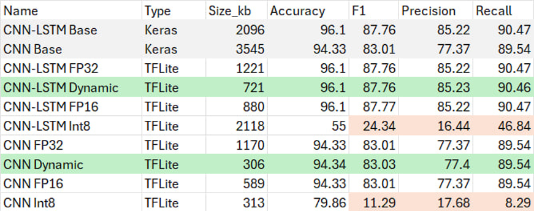
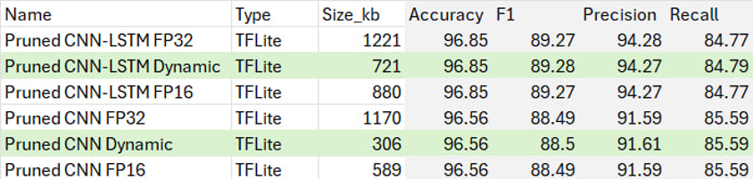
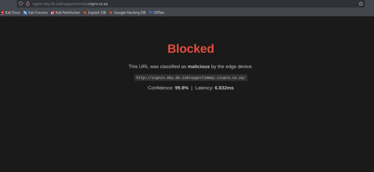
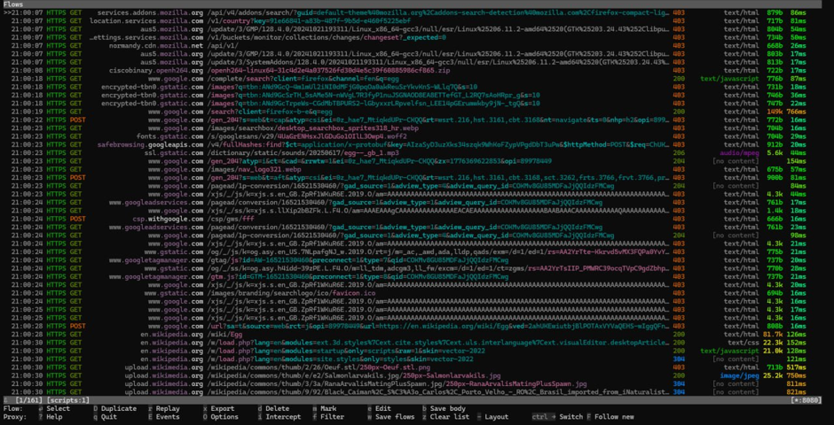

  
## Lightweight Deep Learning for Malicious URL Detection on Edge Devices

A compressed CNN-LSTM model that detects phishing/malicious URLs in real time on a Raspberry Pi 4 — no cloud required. Achieves **96% accuracy** at **6.7ms latency** and **721KB** model size, and is demonstrated end-to-end as a live MITM proxy that blocks malicious links in the browser.

> Final year Honours project, BSc (Hons) Cyber Security and Networks.

> **About this repository:** This is the research report and evidence for the
> project, not a one-command runnable product. Training data comes from third-party
> sources (PhishTank, Kaggle, Tranco, PhiUSIIL) and is not redistributed here;
> live sources change daily, so exact reproduction needs a dated snapshot.

---

## Table of Contents

- [Overview](#overview)
- [Key Results](#key-results)
- [Detection engineering relevance](#detection-engineering-relevance)
- [How It Works](#how-it-works)
- [Tech Stack](#tech-stack)
- [Repository Structure](#repository-structure)
- [Getting Started](#getting-started)
- [Usage](#usage)
- [Evaluation Methodology](#evaluation-methodology)
- [Limitations](#limitations)
- [Future Work](#future-work)
- [License](#license)

---

### Overview

Cloud-based AI phishing detection services are accurate but  introduce  problems such as power consumption, latency, and privacy risks when storing users' data. This project investigated: **can a deep learning model be compressed enough to run directly on a resource-constrained edge device while enabling secure, real-time protection in the absence of cloud services?**

To find out, this project:
1. Built a baseline **CNN** and an improved **CNN-LSTM hybrid** model (based on the URLNet architecture) trained on ~1.68M URLs combined from PhishTank, Kaggle, and Tranco.
2. Compressed the models with **TensorFlow Lite post-training quantisation** (FP16, Dynamic, INT8) and **magnitude-based unstructured pruning** (70% sparsity).
3. Deployed the compressed models on a **Raspberry Pi 4 Model B** and benchmarked accuracy and inference latency.
4. Stress-tested robustness with a **data drift evaluation** on an unseen dataset (PhiUSIIL).
5. Built a working **MITM proxy deliverable** that classifies URLs in a live browser session and blocks malicious ones in real time.

## Key Results

| Model                                 | Accuracy | Size      | Latency (Pi 4) |
| ------------------------------------- | -------- | --------- | -------------- |
| CNN-LSTM (Dynamic quantised)          | 96.1     | 721 KB    | 6.7 ms         |
| CNN-LSTM (Pruned + Dynamic quantised) | 96.85    | 721 KB    | 5.9 ms         |
| CNN (Dynamic quantised)               | 94.34    | 306<br>KB | 4.9 ms         |
| CNN (Pruned + Dynamic quantised)      | 96.56    | 306<br>KB | 6.9 ms         |

**Highlights:**
- Dynamic range quantisation gave the best balance of size, accuracy, and speed — cutting the TFLite model from 1221KB to 721KB with no accuracy loss.
- INT8 quantisation caused the model to collapse (accuracy dropped to 0.55, malicious recall to 0) and was excluded from deployment.
- Pruning improved accuracy after fine-tuning but did **not** reduce latency on the Pi's ARM Cortex-A72 — a useful finding on the limits of unstructured pruning on ARM hardware.
- Under data drift (unseen phishing patterns from a different source), recall dropped from ~90% to ~50–60%, showing that periodic retraining is essential for long-term reliability — model compression was not the limiting factor.

## Detection engineering relevance

This work maps to MITRE ATT&CK **T1566.002 — Spearphishing Link** (Initial Access,
`TA0001`). URLs are classified on-device and malicious links are blocked at the
browser by a mitmproxy addon, giving a local, privacy-preserving enforcement point
instead of a cloud round-trip.

It is an experimental detector, not a production control: the CNN-LSTM result has
about 85% precision, so roughly 15% of blocked URLs would be benign. Threshold
tuning and a measured false-positive profile are needed before real-world use.

## Diagrams & Results

**Baseline CNN and CNN-LSTM Comparison** - CNN-LSTM compression table, the model architecture explained with difference in layers
Changes done to the base model architecture: 
```
Embedding -> Conv3 Layers -> Pool -> Dense -> Output = CNN
Embedding -> Conv1 Layer -> LSTM -> Pool -> Dense -> Output = CNN-LSTM
```
Comparison between 2 models:

| Name     | Accuracy | F1    | Precision | Recall | Size_kb |
| -------- | -------- | ----- | --------- | ------ | ------- |
| CNN      | 94.33    | 83.01 | 77.37     | 89.54  | 3545    |
| CNN-LSTM | 96.1     | 87.76 | 85.22     | 90.47  | 2096    |

**Quantisation comparison** — Dynamic range quantisation gave the best size/accuracy trade-off across both architectures:



**Quantisation + pruning combined** — pruned, fine-tuned, and quantised variants:

After pruning with a sparsity of 70% and eight epochs of fine-tuning, the CNN model increased its accuracy from 0.94 to 0.96, while the CNN-LSTM hybrid showed only a slight improvement. The most accurate result from compression has been achieved by combining pruning and quantisation




**Data drift evaluation** — accuracy/recall of all 16 model variants on the unseen PhiUSIIL dataset:


**Live MITM proxy demo** — a malicious URL blocked in real time, showing the model's probability and latency:

All four models that were deployed on the Raspberry Pi have shown successful results. The highest accuracy in the experiment was achieved by a pruned dynamic CNN with 96,60%, and by a pruned dynamic CNN-LSTM with 96,45%

The MITM proxy setup demonstrated that the compressed CNN-LSTM can be deployed to detect malicious links without relying on cloud services. The HTTP requests were successfully intercepted, classified, and blocked if the URL was malicious, with latency under 7ms, showing no degradation of the browsing experience.

The system operated fully locally; the data was analysed on a local edge device, and the blocking decision was made before the request reached the outside server. 




**Proxy logging mode** — non-blocking traffic inspection view:



Demo of the delivarable:
[video](assets/demo_showcase.mp4)

## Hypothesis Evaluation

| Hypothesis | Outcome |
|---|---|
| H0 — compression cannot preserve baseline performance | **Rejected** — pruned models even exceeded baseline accuracy after fine-tuning |
| H1 — light compression preserves classification performance | **Supported** — FP16 preserved 0.96 accuracy |
| H2 — moderate compression gives the best size/performance balance | **Supported** — Dynamic quantisation gave 40–60% size reduction with no accuracy loss |
| H3 — heavy compression degrades performance | **Partially supported** — INT8 collapsed the model, but 70% sparsity pruning improved accuracy after fine-tuning; the *method* mattered more than compression intensity |

## Data Drift Results (PhiUSIIL, unseen dataset)

Project have shown that the compression is not the limiting factor in deploying the deep learning models. instead it is the drift of pattern detection compared to unseen data.

| Condition                                                                                     | Recall  |
| --------------------------------------------------------------------------------------------- | ------- |
| On original training/test distribution                                                        | ~90%    |
| On unseen drift dataset (PhiUSIIL, sourced independently, deduplicated against training data) | ~50–60% |

The ~30-point recall drop was consistent across **all 16 model variants**, regardless of compression method or intensity — meaning it isn't a side effect of quantisation or pruning. 

This shows that even wider dataset variety is needed as well as retraining and additional calibration, they are flagged as the top priority in [Future Work](#future-work), not further compression.


**Main findings**
1. Dynamic range quantisation was most effective for CNN-based URL detection models compared to other variants, such as FP16 and INT8

2. The failure of INT8 shows that preserving floating-point in CNN architectures is non-negotiable for this architecture. 

3. Magnitude-based pruning on ARM hardware provides accuracy recovery after the fine-tuning, rather than compression efficiency. 

4. Data drift was the main limitation of the chosen approach.  Recall degradation is observed across all models, regardless of modifications, indicating that the issue lies in the baseline training and the dataset's limitations rather than the model architecture or the applied compression techniques
   

## How It Works

```
Raw URLs (PhishTank, Kaggle, Tranco)
        │
        ▼
Canonicalisation & Tokenisation (char-level, 200-char limit)
        │
        ▼
CNN-LSTM Model Training (class-weighted, 70/15/15 split)
        │
        ▼
TFLite Conversion → Post-Training Quantisation → Pruning + Fine-tuning
        │
        ▼
Deployment on Raspberry Pi 4 (via ai_edge_litert)
        │
        ▼
MITM Proxy → real-time URL interception & blocking
```

The CNN-LSTM architecture embeds each character of a URL, passes it through a convolutional layer and an LSTM layer to capture sequential structure, then classifies the URL as benign or malicious.

## Tech Stack

| Category | Tools |
|---|---|
| Language | Python |
| Modelling | TensorFlow, Keras |
| Data processing | pandas, NumPy, scikit-learn, Matplotlib |
| Deployment runtime | TensorFlow Lite, ai_edge_litert |
| Edge hardware | Raspberry Pi 4 Model B (4GB) |
| Real-time deliverable | mitmproxy |
| Dev environment | Visual Studio Code |

## Repository Structure

```
├── 01-Datasets/
│   ├── README.md                    # links to download PhishTank/Kaggle/Tranco/PhiUSIIL sources
│   ├── 01_clean_urls.py
│   ├── 02_data_merge.py
│   ├── 03_data_split.py
│   ├── 04_tokenize_pad.py
│   ├── 05_seed_eval_generate.py    # run with --seed 8 / --seed 43
│   └── char_to_idx_reproduce.json   # tokenisation vocabulary, needed everywhere downstream
│
├── 02-Model_training/
│   ├── base_training/
|	|	├── baseline.py
|	│   └── lstm_base_1.py
│   └── compression/
|		├── 8bit_conversion_failed.py   #failed approach documentation
|		├── compression_comparison.py
|	    └── pruning.py
|
├── 04-Deployment/                      # everything that physically ran on the Pi (transferred via SCP)
│   ├── pi_predict.py
│   ├── 02_mitmproxy.py
│   ├── pi_evaluation.py
│   └── README.md                    # Pi setup: venv, SSH access, files transferred, run commands
│
├── 03-Evaluation/
│   ├── model_evaluation.py
│   └── results/
|	    ├── evaluation_all_seed_8.csv
|	    ├── evaluation_all_seed_43.csv
│       └── evaluation_all_seed_69.csv
│
├── 05-Drift/
│   ├── 01_data_merge_drift_new.py    # removes overlap with training set
│   ├── 02_drift_tokenise.py
│   ├── 03_drift_evaluation.py
│   └── results/
|		├── drift_results.csv
│       └── evaluation_all_drift.csv
|
├── Common/
│   └── preprocessing.py             # shared canonicalize_url() / tokenize(), imported by every stage
│
├── Models/
│   ├── base_models/
|	|	├── baseline_cnn.h5
|	|	└── cnn_lstm1.keras
│   └── deployed_models/                    # the 4 dynamic-quantised .tflite models actually run on the Pi
|		├── cnn_dynamic.tflite
|		├── lstm_dynamic.tflite
|		├── prune70cnn_dynamic.tflite
|		└── prune70lstm_dynamic.tflite
│
├── extra_deployment_option/
│   └── pi_api_flask.py              # prototype REST API, not used in the final proxy deliverable
│
├── assets/                          # figures/diagrams used in this README
└── README.md
```

> Note: the `04-Deployment/` code ran directly on the Raspberry Pi over SSH, which was set up as a standalone environment separate from the main development machine — all files it needs (models, `char_to_idx_reproduce.json`, tokenisation logic) were transferred over via SCP rather than imported across machines, hence the shared logic being duplicated there via `Common/preprocessing.py`.

## Getting Started

### Prerequisites
- Python 3.11+
- pip / virtualenv
- (For the live demo) a Raspberry Pi 4 and a client machine on the same network

### Installation

```bash
git clone https://github.com/dusty-spider/malicious-url-edge-detection.git
cd malicious-url-edge-detection
python -m venv venv
source venv/bin/activate      # Windows: venv\Scripts\activate
pip install -r requirements.txt
```

> The package list is in `requirements.txt` at the repository root; `.gitignore`
> keeps caches, virtual environments and raw data out of commits. This repository
> documents the research; the training data is third-party and is not
> redistributed here.

## Usage

**1. Prepare the dataset** (see `01-Datasets/README.md` for source download links):
```bash
python 01-Datasets/01_clean_urls.py
python 01-Datasets/02_data_merge.py
python 01-Datasets/03_data_split.py
python 01-Datasets/04_tokenize_pad.py
```

**2. Train the models:**
```bash
python 02-Model_training/base_training/baseline.py
python 02-Model_training/base_training/lstm_base_1.py
```

**3. Compress (quantise + prune):**
```bash
python 02-Model_training/compression/compression_comparison.py 
python 02-Model_training/compression/pruning.py 
```

**4. Evaluate:**
```bash
python 03-Evaluation/model_evaluation.py
```

**5. Deploy to the Pi** (see `04-Deployment/README.md`):
```bash
user@machine:~/modeltest $ mitmproxy -s 02_mitmproxy.py --listen-host 0.0.0.0 --listen-port 8080
```
Point your browser's proxy settings at the Pi and install mitmproxy's CA certificate on the client — malicious links will be blocked with a warning page showing the model's confidence and latency.

**6. Drift** 
Optional for the end result, continue if you would like to perform your own testing further. Remember to pick your own datasets and specify path.
```bash
python 05-Drift/01_data_merge_drift_new.py
python 05-Drift/02_drift_tokenise.py
python 05-Drift/03_drift_evaluation.py
```
## Evaluation Methodology

- **Classification metrics:** Accuracy, Precision, Recall, F1-score, measured with a 0.5 classification threshold.
- **Latency:** Each sample run 100 times on the Pi; first 10 runs discarded as warm-up; average reported across 3 seeded test splits.
- **Drift test:** A separate, unseen dataset (PhiUSIIL, ~231K URLs) was used to test generalisation to new phishing patterns not seen during training.

## Limitations

- Latency was measured on a 2,000-sample subset per run rather than the full test set, due to Pi memory constraints.
- Manual/unstructured pruning is less reproducible than structured pruning approaches.
- No thermal throttling controls were applied during Raspberry Pi benchmarking.
- The proxy deliverable analyses URL structure only — it does not inspect page content, so malicious content hosted on legitimate domains is not detected.
- Recall degrades notably on unseen phishing patterns, highlighting a dependency on dataset freshness rather than model architecture.

## Future Work

- Automatic/periodic retraining pipeline to counter data drift.
- Construction of balanced, more variable dataset to counter the initial data drift.
- Structured pruning to unlock further compression and support even lower-power hardware.
- Extending detection beyond per-device URL analysis to network-wide deployment and lightweight page-content inspection.

## License

MIT

If you have any questions or interested in more details/explanation to the compression processes please don't hesitate to contact me. 
## Acknowledgments

Built as a final-year Honours project for BSc (Hons) Cyber Security and Networks. Datasets: PhishTank, Kaggle, Tranco, PhiUSIIL.